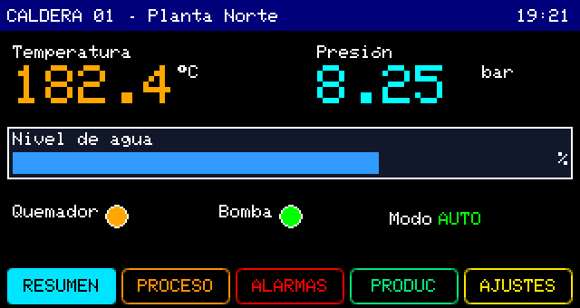
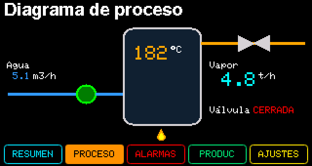

# 05.HMI_Plantilla_Caldera — plantilla de HMI completa

Una HMI industrial de cinco páginas para una caldera, hecha con el **JWPLC HMI Designer**. Úsala como
**plantilla**: ya trae todos los tipos de objeto colocados y nombrados; tú solo conectas tus señales.

 

## Qué trae

| Página | Qué enseña |
|---|---|
| Resumen | Reloj del RTC en la barra de título, temperatura y presión grandes, nivel (BAR), pilotos de quemador y bomba, modo (TEXT) |
| Proceso | Un diagrama con figuras (líneas, elipse, rectángulo redondeado, triángulos) y una llama dibujada en capas PIXEL |
| Alarmas | Tres BOOL que se ponen en rojo con la alarma, un aviso en PIXEL y la última alarma en texto |
| Producción | Contador con separador de miles, horómetro (duración), eficiencia y combustible (BAR) |
| Ajustes | MENU con consignas, modo y submenús de protecciones y mantenimiento |

Barra de páginas con color por página, arranque en IDLE y vuelta a IDLE por inactividad (300 s).
31 de los 32 objetos posibles.

## Cómo usarla

1. **Archivo → Ejemplos → JWPLC_Display → 05.HMI_Plantilla_Caldera** y luego **Archivo → Guardar como**
   (los ejemplos del package son de solo lectura).
2. Sube el sketch tal cual: verás todas las páginas con valores fijos. Navega con ◀ ▶ y entra con OK.
3. En `loop()` cambia cada `= 0.0f` o `= false` por tu lectura real, por ejemplo:

   ```cpp
   temperatura = leerTermocupla();
   bomba = digitalRead(I0_1);
   ```

   La pantalla solo redibuja lo que cambia; no llames a funciones de dibujo.

## Editarla

Abre el sketch guardado con el **HMI Designer** (botón del Arduino IDE o *Sketch: Abrir HMI del sketch*):
carga `05.HMI_Plantilla_Caldera.jwhmi`. Mueve, renombra o borra objetos y pulsa **«Escribir en sketch»**:
el Designer actualiza `JWPLC_HMI_Generated.h` y `JWPLC_HMI_LEEME.md`, **nunca tu `.ino`**.

`JWPLC_HMI_LEEME.md` lista todas las variables, el MENU y el sketch base.

## Bueno saber

- Cada campo tiene su propia variable: si quieres la misma temperatura en dos páginas, asígnala a las dos.
- Las capas PIXEL quedan detrás de las figuras; por eso la llama está debajo de la caldera.
- No edites `JWPLC_HMI_Generated.h` a mano: el Designer lo sobrescribe.
