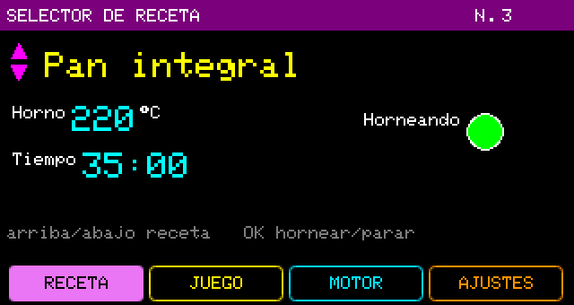
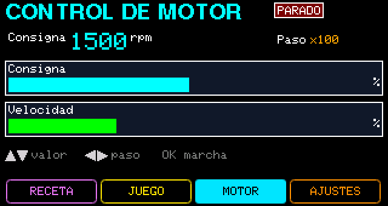

# 06.HMI_Botonera_Interactiva — la botonera hace algo más que cambiar de página

Cuatro páginas donde las teclas controlan la lógica del sketch: un horno con recetas, un juego de reflejos
y un motor con rampa. Enseña **cómo leer la botonera sin pelear con la pantalla**.

 

## Cómo se usa

En el selector de páginas ◀ ▶ cambian de página y **OK entra**. Dentro de una página las teclas son del
sketch y **ESC vuelve** al selector.

| Página | Teclas | Qué pasa |
|---|---|---|
| Receta | ▲▼ elige entre 5 recetas · OK hornea / para | Cambian nombre, temperatura y tiempo; OK arranca la cuenta atrás (MM:SS) y enciende el piloto «Horneando». Sigue aunque salgas de la página. |
| Reflejos | OK empieza · OK cuando la luz se pone verde | Mide tu tiempo de reacción en ms, avisa «TEMPRANO!» o «LENTO...», guarda el récord y muestra el trofeo. |
| Motor | ▲▼ consigna · ◀ ▶ paso x1/x10/x100 · OK marcha/paro | La velocidad sigue a la consigna con la rampa del MENU; dos barras: consigna y velocidad real. |
| Ajustes | MENU (lo maneja el firmware) | Rampa del motor, espera máxima del juego, partidas jugadas y «Borrar récord». |

## La regla que enseña

El sketch solo lee teclas cuando **su** página está abierta en modo contenido:

```cpp
// true sólo si la página p está abierta en modo contenido (teclas del usuario).
static bool enContenido(uint8_t p)
{
    return !JWPLC_Display.isIdleMode() &&
           !JWPLC_Display.isUserPageSelection() &&
           JWPLC_Display.userPage() == p;
}
```

Así nunca compite con la pantalla de reposo, el selector de páginas ni el MENU (Ajustes), que usan las
mismas teclas.

## Bueno saber

- El Arduino IDE pone los prototipos de funciones **antes** de los `enum`: una función que recibe un tipo
  `enum` propio no compila en ESP32. El ejemplo pasa esos valores como `uint8_t`.
- `setPixelMapVisible()` redibuja la página entera: el sketch solo lo llama cuando el trofeo cambia.
- Guarda una copia (**Archivo → Guardar como**) antes de modificarlo; ábrela con el HMI Designer para
  editar el diseño (`06.HMI_Botonera_Interactiva.jwhmi`).
