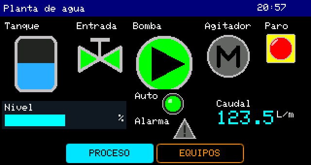
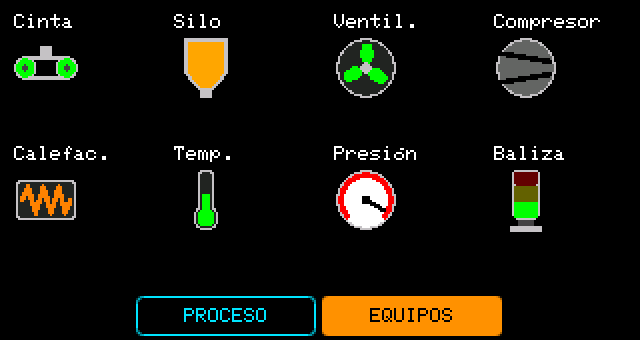

# 07.HMI_Iconos_Planta — iconos con estado

Una planta de agua simulada con **15 iconos con estado** (tipo ICON): tanque, válvulas, bombas, motores,
pilotos, sensores y baliza. Cada icono cambia de imagen según su variable.

 

## Cómo se usa

| Página | Qué muestra | Teclas (dentro de la página) |
|---|---|---|
| Proceso | Tanque (4 niveles), válvula de entrada, bomba, agitador, paro, piloto de modo y alarma; barra de nivel y caudal | OK paro de emergencia (enclavado) · ▲ automático/manual · ▼ simula una falla de la bomba |
| Equipos | Cinta, silo, ventilador, compresor, calefacción, temperatura, presión y baliza | — |

El tanque se llena por la válvula y la bomba lo vacía. Con el paro todo se detiene y la baliza se pone roja;
con la falla, la bomba muestra su estado «Falla» y la presión pasa a «Alta».

## La idea

Un icono es una variable: `bool` para dos estados o `uint8_t` para más. El header generado comenta qué
significa cada número:

```cpp
uint8_t bomba = 0; // ICON: 0=Parado 1=En marcha 2=Falla
```

El sketch usa nombres en vez de números sueltos y solo cambia la variable; el icono se repinta solo cuando
el estado cambia:

```cpp
enum : uint8_t { PARADO = 0, MARCHA = 1, FALLA = 2 };
bomba = fallaBomba ? FALLA : (vaciando ? MARCHA : PARADO);
```

## Bueno saber

- Los iconos salen de la biblioteca del Designer (botón **«Iconos»** de la barra del lienzo): 24 iconos en
  8 categorías, de 24 a 64 px.
- Un ICON cuenta en el límite de 32 objetos por proyecto.
- Guarda una copia (**Archivo → Guardar como**) antes de modificarlo; ábrela con el HMI Designer para editar
  el diseño (`07.HMI_Iconos_Planta.jwhmi`).
