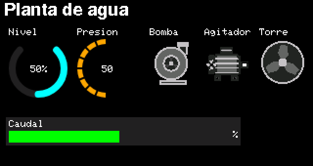

# 08.HMI_Medidores_Animados — medidor circular e iconos animados

Una planta de agua simulada con dos **medidores circulares**, una barra de caudal y tres **iconos animados**.



## Cómo se usa

| Página | Qué muestra | Teclas (dentro de la página) |
|---|---|---|
| Proceso | Nivel (arco de 270°, porcentaje al centro), presión (180° por segmentos, valor al centro), caudal, bomba, agitador y ventilador | OK paro general (enclavado) · ▼ simula una falla de la bomba |

El tanque se llena solo y la bomba lo vacía entre 70 % y 30 %. Con la bomba en marcha sube la presión y
aparece el caudal; con nivel sobre 50 % arranca el ventilador.

## La idea

- **Medidor circular:** es un campo «Indicador de nivel» con forma *Circular* en el Designer. Declara un
  `float` como la barra lineal; el sketch solo escribe el valor (`nivel = nivelSim;`).
- **Iconos animados:** los iconos del catálogo con varios cuadros (motor, bomba, ventilador, agitador,
  pistón, transportador) se animan solos en el estado «En marcha». El sketch solo cambia el estado:

```cpp
bomba = fallaBomba ? FALLA : (vaciando ? MARCHA : PARADO);
```

## Bueno saber

- La animación la dibuja la librería con el refresco parcial: solo se repinta el icono que cambia de cuadro.
- Ábrelo con el HMI Designer para editar el diseño (`08.HMI_Medidores_Animados.jwhmi`).
