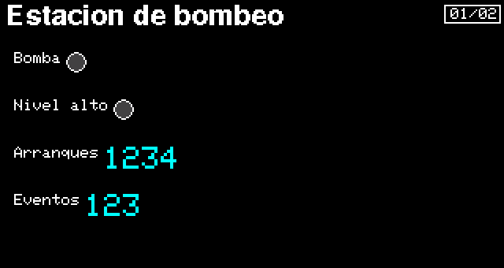
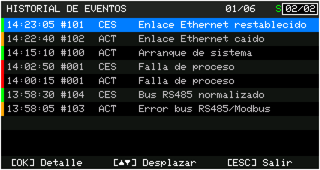

# 09.HMI_Registro_Eventos — historial de eventos

Una estación de bombeo simulada que anota sus eventos y los muestra en una página de **historial**.

 

## Cómo se usa

| Página | Qué muestra | Teclas (dentro de la página) |
|---|---|---|
| Proceso | Bomba, alarma de nivel alto, arranques y eventos anotados | OK paro por operador (enclavado) |
| Eventos | Hora, código, ACTIVO/CESÓ y texto de cada evento | ▲ ▼ desplazan · OK detalle · ESC sale |

## La idea

Cada evento es un código. El Designer guarda en la página «Eventos» la tabla con el texto, la severidad y
la categoría de cada código; el sketch solo anota el código y si se activó o cesó:

```cpp
JWPLC_Display.logEvent(EV_NIVEL_ALTO, alta ? JWPLC_EVENT_TRANS_ACTIVE : JWPLC_EVENT_TRANS_NORMAL);
```

- El arranque del equipo (código 100) lo anota la librería al iniciar el historial.
- `JWPLC_Display.eventCount()` dice cuántos eventos hay.
- Los últimos 16 quedan en la FRAM y vuelven tras un corte de luz; con microSD se copian a `/EVENTOS.CSV`.

## Bueno saber

- Ábrelo con el HMI Designer para editar el diseño (`09.HMI_Registro_Eventos.jwhmi`).
