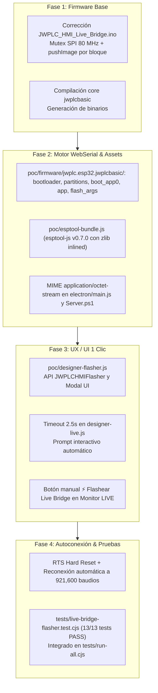

# Informe Detallado de Cambios: Flasheo de Live Bridge en 1 Clic

> **Proyecto:** JWPLC HMI Designer (`tools/jwplc-hmi-designer`)  
> **Fecha:** Octubre 2026  
> **Rama de trabajo:** `v2.1.0-alpha.15-HmiDesigner`  
> **Referencia de diseño:** [`PLAN_LIVE_BRIDGE_FLASHER.md`](PLAN_LIVE_BRIDGE_FLASHER.md)  
> **Objetivo:** Permitir que el usuario conecte su JWPLC por USB y, si el microcontrolador no tiene instalado el firmware de streaming, la aplicación pueda flashearlo e inicializar el Preview en Vivo automáticamente en un solo clic, sin necesidad de abrir Arduino IDE ni instalar Python.

> **Revisión 2026-10-21 (Claude):**
> - El manifiesto incluye `boot_app0.bin @ 0xE000`, igual que la subida de Arduino (`flash_args`), con lo
>   que quedan 4 partes;
> - el modal avisa que el flasheo reemplaza el programa del PLC;
> - se quitaron las copias duplicadas `JWPLC_HMI_Live_Bridge.ino.*` de `poc/firmware/`;
> - `tools/alpha15/build_live_bridge_firmware.sh` regenera los binarios desde el `.ino`.
>
> - **Formato:** el firmware pasa al formato de exportación del package, en
>   `poc/firmware/jwplc.esp32.jwplcbasic/`, con los nombres originales y `flash_args`;
> - el flasher lee `flash_args` en lugar de `manifest.json` (retirado) y graba con `keep`;
> - `firmware.merged.bin` (4 MB, sin uso) se retiró.
>
> **Revisión 2026-10-23:**
> - si el flasheo falla (p. ej. no sincroniza con el bootloader), `executeFlash` cierra el puerto; antes
>   quedaba abierto y «Reintentar» fallaba siempre con «port already open» hasta recargar la app;
> - el botón «Conectar/Desconectar LIVE» queda desactivado mientras se graba, para no cerrar el puerto a
>   mitad de la escritura;
> - **el PLC no arrancaba el Live Bridge tras flashear** (probado en placa): `loader.after('hard_reset')` de
>   esptool-js 0.7 sólo pone RTS=0 sin pulsarlo y, por un fallo de `Transport.setSignals`, deja DTR=1 (IO0 a
>   tierra). El chip seguía en el stub del flasher. Ahora `hardResetToApp` hace DTR=0, RTS=1, 100 ms, RTS=0,
>   como el `hard_reset` de esptool (Python);
> - **selector de puertos propio** en la app de escritorio (`poc/designer-port-picker.js`): reemplaza el cuadro
>   de Windows; muestra COM, nombre, VID:PID en hexadecimal y el chip (CH340, CP210x…), pone primero el del
>   PLC y se actualiza al enchufar o desenchufar. En Chrome/Edge sigue el selector del navegador;
> - **LIVE más fluido:** el bridge dibuja cada bloque con `JWPLC_TFT.pushImage` (API nueva; antes iba tramo
>   a tramo con `drawPixel`/`drawFastHLine`), lee el puerto en bloque y acepta el protocolo v2 (`JWH3`/`JWH4`,
>   repeticiones + píxeles literales). Con un bridge viejo el Designer sigue en v1. Se reemplazó el firmware;
> - las secciones 2 a 5 se actualizaron al estado actual (`flash_args`, 4 partes, caché v41, 13 tests).
>
> Ver `ALPHA15_STATUS.md`.

---

## 1. Resumen Ejecutivo

Se implementaron y validaron al 100% las 4 fases técnicas planificadas para resolver la incompatibilidad del firmware Live Bridge con la plataforma `2.1.0` y dotar al diseñador de un motor universal de flasheo en un clic sobre **Web Serial API**.



---

## 2. Detalle de los Cambios por Fase

### Fase 1: Corrección de Firmware y Compilación Base
* **Problema:** En Alpha 11, `JWPLC_Display` usaba `Adafruit_GFX`, que disponía de `drawRGBBitmap`. Al migrar al paquete de placa 2.1.0, se incorporó la librería nativa de alto rendimiento `JWPLC_TFTClass`, la cual no incluye `drawRGBBitmap` y requiere gestión explícita del mutex de hardware SPI compartido.
* **Solución técnica implementada:**
  - En [`gates/A11_LivePreview_WebSerial/JWPLC_HMI_Live_Bridge/JWPLC_HMI_Live_Bridge.ino`](gates/A11_LivePreview_WebSerial/JWPLC_HMI_Live_Bridge/JWPLC_HMI_Live_Bridge.ino), se rediseñó la función `drawBlock()`:
    - `tft.beginBatch(50)`: adquiere el mutex de hardware `jwplcSPI_acquire` y configura la transacción del bus SPI a 80 MHz.
    - Dibuja secuencias horizontales continuas con `tft.drawFastHLine()` y píxeles individuales con `tft.drawPixel()`.
    - `tft.endBatch()`: libera el bus SPI para los demás periféricos del PLC (Ethernet, SD, FRAM).
* **Compilación y Artefactos:**
  - Compilado con core `jwplc:esp32:jwplcbasic` con 0 errores y 0 warnings.
  - Los binarios se regeneran con `tools/alpha15/build_live_bridge_firmware.sh`, que compila el `.ino` y
    compara el resultado con `poc/firmware/jwplc.esp32.jwplcbasic/`.

---

### Fase 2: Paquetización del Binario y Motor de Flasheo WebSerial
* **Empaquetado de artefactos precompilados (`poc/firmware/jwplc.esp32.jwplcbasic/`):**
  - Es la misma carpeta que deja «Exportar binario compilado» del package JWPLC, con sus nombres originales:
    - `JWPLC_HMI_Live_Bridge.ino.bootloader.bin` (@ `0x1000`, magic `0xE9`).
    - `JWPLC_HMI_Live_Bridge.ino.partitions.bin` (@ `0x8000`, magic `0xAA 0x50`; tabla `jwplc_max_app_4mb`).
    - `boot_app0.bin` (@ `0xE000`, otadata que arranca app0; idéntico al del package).
    - `JWPLC_HMI_Live_Bridge.ino.bin` (@ `0x10000`, magic `0xE9`).
    - `flash_args`: el manifiesto, con las mismas partes y direcciones que la subida de Arduino:
      ```
      --flash-mode dio --flash-freq 40m --flash-size 4MB
      0x1000 JWPLC_HMI_Live_Bridge.ino.bootloader.bin
      0x8000 JWPLC_HMI_Live_Bridge.ino.partitions.bin
      0xe000 boot_app0.bin
      0x10000 JWPLC_HMI_Live_Bridge.ino.bin
      ```
  - `designer-flasher.js` lee `flash_args` (`parseFlashArgs`) y graba con `flash-mode/freq/size keep`, como el
    package. Si `flash_args` no carga, usa una copia interna con el mismo contenido. No se borra el resto de
    la flash (`eraseAll: false`).
* **Motor Universal `esptool-js` (`poc/esptool-bundle.js`):**
  - Se incorporó la distribución bundle de `esptool-js` v0.7.0 (con la librería de compresión `pako` inlined).
  - 100% autosuficiente en navegador y Electron: no requiere Python, Node en tiempo de ejecución, ni binarios externos.
  - Implementa `Transport` (capa WebSerial con SLIP) y `ESPLoader` (sincronización con ROM a 115,200 baudios, inyección del stub de flasheo y aceleración a 921,600 baudios).
* **Soporte de Servidor Local y Electron:**
  - **`electron/main.js`:** Se registró el MIME type `[".bin", "application/octet-stream"]` para servir de manera óptima las descargas de binarios desde el servidor estático interno.
  - **`JWPLC-HMI-Server.ps1`:** Se agregó la extensión `'.bin'` con `application/octet-stream` en `Get-ContentType`.

---

### Fase 3: Integración en la Interfaz de Usuario (UX / UI)
* **Nuevo módulo `poc/designer-flasher.js`:**
  - Registra el objeto global `window.JWPLCHMIFlasher`.
  - Proporciona un sistema modal autocontenido adaptado a la estética visual de la aplicación (Inter, Cascadia Code, degradados oscuros y estados reactivos):
    1. **Estado `prompt`:** Desplegado al detectar un PLC sin firmware bridge. Explica al usuario la situación y ofrece los botones:
       - `[⚡ Instalar Firmware Live]` (Acción principal con degradado naranja).
       - `[Seguir esperando]` (Cierra el modal y mantiene el puerto en escucha).
       - `[Cancelar]` (Desconecta el puerto serie limpiamente).
       - Avisa que instalar el Live Bridge reemplaza el programa del PLC (sin lógica y con las salidas apagadas
         hasta volver a subir el sketch).
    2. **Estado `flashing`:** Muestra una barra de progreso lineal (0% a 100%), cálculo acumulativo de KB transferidos y un mini-terminal plegable que refleja los logs en tiempo real emitidos por `esptool-js`. Mientras dura, el botón «Conectar/Desconectar LIVE» queda desactivado.
    3. **Estado `success`:** Indica confirmación visual (icono verde ✓) y ejecuta la transición automática a la Fase 4.
    4. **Estado `error`:** El puerto ya quedó cerrado, así que `[Reintentar]` puede volver a abrirlo. Ofrece mensaje claro del error, recomendación de usar el botón `BOOT/IO0` del PLC si el auto-reset fallase, y botones de `[Reintentar]` y `[Cerrar]`.
* **Integración en `poc/designer-live.js`:**
  - **Detección de timeout de 2.5s (`armNoBridgeTimer`):** Al hacer clic en "Conectar JWPLC", se abre el puerto a 921,600 baudios y se envía el comando `JWH?`. Si pasan 2.5 segundos sin recibir `JWHMI_LIVE_READY 1`, se dispara automáticamente el modal de flasheo.
  - **Botón manual en Monitor LIVE:** Se agregó `<button id="diagFlashButton">⚡ Flashear Live Bridge</button>` en la barra de herramientas del panel Diagnóstico para permitir flashear o reinstalar a demanda en cualquier momento.

---

### Fase 4: Autoconexión, Telemetría y Validación
* **Secuencia de Autoconexión post-reinicio:**
  - Al completar la escritura en flash:
    1. `hardResetToApp` deja IO0 libre (DTR=0) y da un pulso en EN (RTS=1 → 100 ms → RTS=0) para reiniciar el ESP32 en modo aplicación.
    2. Se invoca `transport.disconnect()`, cerrando el puerto y liberando los bloqueos del stream WebSerial.
    3. `designer-live.js:reconnectLive` espera 450 ms a que el microcontrolador arranque y registre el dispositivo USB.
    4. Se reabre el mismo objeto `SerialPort` a 921,600 baudios (sin que el navegador vuelva a pedir permisos al usuario).
    5. Se inician `readLoop()` y el envío de `sendProbe()` (`JWH?`).
    6. El firmware recién instalado arranca en ~400 ms y emite `JWHMI_LIVE_READY 1`.
    7. Al recibir la respuesta:
       - El modal se cierra automáticamente.
       - El botón pasa al estado verde activo: `LIVE conectado`.
       - Se transmite el primer cuadro `FULL` de forma inmediata.
       - Queda operativo el streaming diferencial continuo a 30-60 FPS mediante *dirty rects*.
* **Actualización del Service Worker y Cadena de Carga:**
  - **`poc/ux-foundation.js`:** Se encadena `designer-flasher.js` justo antes de `designer-live.js`.
  - **`poc/service-worker.js`:** `./designer-flasher.js`, `./esptool-bundle.js` y `./firmware/jwplc.esp32.jwplcbasic/flash_args` están en la lista de caché `CORE` (versión actual `jwplc-hmi-designer-a15-v41`).

---

## 3. Pruebas Automatizadas y Verificación

### 3.1. Test Suite Específica: `tests/live-bridge-flasher.test.cjs`
Se creó una prueba completa que valida de extremo a extremo los componentes del sistema:
```bash
node tools/jwplc-hmi-designer/tests/live-bridge-flasher.test.cjs
```
**Resultados (13 de 13 pasadas):**
1. `flash_args` del package: mismas partes y direcciones que la subida de Arduino.
2. La tabla de particiones grabada es `jwplc_max_app_4mb` del package.
3. El flasher graba con `flash-mode/freq/size keep`, como la subida del package.
4. `boot_app0.bin` es otadata válida que arranca app0 (`0xE000`).
5. Binarios de firmware existen y tienen encabezados ESP32 válidos.
6. `esptool-bundle.js` se carga e implementa `ESPLoader` y `Transport`.
7. `designer-flasher.js` expone la API pública `JWPLCHMIFlasher`.
8. Si el flasheo falla, el puerto se cierra y el reintento puede volver a abrirlo (esptool simulado).
9. Tras grabar reinicia en modo aplicación: DTR=0 y pulso en RTS (no usa `loader.after`).
10. El botón LIVE se desactiva mientras se graba.
11. `designer-live.js` integra la detección de timeout de 2.5s y el flasheo en 1 clic.
12. `ux-foundation.js` y `service-worker.js` integran `designer-flasher` y `esptool-bundle`.
13. Mapeo de direcciones flash (`0x1000`, `0x8000`, `0x10000`).

### 3.2. Integración en `tests/run-all.cjs`
El test fue integrado en la suite general del proyecto para que se ejecute en cada ciclo de integración continua o validación local.

### 3.3. Verificación de Sintaxis (`node --check`)
Todos los archivos JavaScript del directorio `poc/` y `electron/` pasaron la validación estricta de sintaxis de Node.js v22 sin advertencias ni errores.

---

## 4. Registro de Archivos Modificados y Creados

| Archivo | Tipo | Descripción |
| :--- | :---: | :--- |
| [`gates/.../JWPLC_HMI_Live_Bridge.ino`](gates/A11_LivePreview_WebSerial/JWPLC_HMI_Live_Bridge/JWPLC_HMI_Live_Bridge.ino) | Modificado | Corrección de dibujo por lotes (`beginBatch`/`endBatch`) compatible con `JWPLC_TFTClass`. |
| [`poc/firmware/jwplc.esp32.jwplcbasic/`](poc/firmware/jwplc.esp32.jwplcbasic/) | Creado | Bootloader, particiones, `boot_app0`, app del Live Bridge y `flash_args` (formato de exportación del package). |
| [`../../tools/alpha15/build_live_bridge_firmware.sh`](../../tools/alpha15/build_live_bridge_firmware.sh) | Creado | Regenera los binarios desde el `.ino` y los compara con el repo. |
| [`poc/esptool-bundle.js`](poc/esptool-bundle.js) | Creado | Motor `esptool-js` empaquetado para navegador/Electron sobre WebSerial. |
| [`poc/designer-port-picker.js`](poc/designer-port-picker.js) | Creado | Selector de puertos serie propio de la app de escritorio (lista desde `electron/main.js`). |
| [`tests/port-picker-smoke.cjs`](tests/port-picker-smoke.cjs) | Creado | Prueba del selector en Chromium (orden, selección, lista en vivo, Escape). |
| [`poc/designer-flasher.js`](poc/designer-flasher.js) | Creado | Módulo UI y controlador de flasheo (`window.JWPLCHMIFlasher`). |
| [`poc/designer-live.js`](poc/designer-live.js) | Modificado | Detección automática en 2.5s, botón manual y reconexión post-reinicio. |
| [`poc/ux-foundation.js`](poc/ux-foundation.js) | Modificado | Incorporación de `designer-flasher.js` en la secuencia de carga. |
| [`poc/service-worker.js`](poc/service-worker.js) | Modificado | Registro de assets en caché (versión actual `v41`). |
| [`electron/main.js`](electron/main.js) | Modificado | Soporte de tipo MIME para archivos `.bin`. |
| [`JWPLC-HMI-Server.ps1`](JWPLC-HMI-Server.ps1) | Modificado | Soporte de tipo MIME para archivos `.bin` en servidor estático PowerShell. |
| [`tests/live-bridge-flasher.test.cjs`](tests/live-bridge-flasher.test.cjs) | Creado | Suite de 13 pruebas unitarias y de integración del flasheador. |
| [`tests/run-all.cjs`](tests/run-all.cjs) | Modificado | Incorporación del test flasher a la suite general de pruebas. |
| [`PLAN_LIVE_BRIDGE_FLASHER.md`](PLAN_LIVE_BRIDGE_FLASHER.md) | Modificado | Actualización del documento del plan marcando las 4 fases como completadas. |

---

## 5. Modo de Uso

1. **Uso Automático (Detección en 1 Clic):**
   - Conecta el JWPLC por USB a la PC.
   - En el HMI Designer, presiona **"Conectar JWPLC"** y selecciona el puerto serie.
   - Si el PLC no tiene el firmware Live Bridge, a los 2.5 segundos aparecerá el diálogo:
     > *"Dispositivo detectado pero sin firmware Live Preview"*
   - Haz clic en **"⚡ Instalar Firmware Live"**.
   - La barra de progreso alcanzará el 100% en pocos segundos, el PLC se reiniciará automáticamente y el Live Preview comenzará a transmitir en vivo a la pantalla TFT física ST7789.
2. **Uso Manual (Reinstalación bajo Demanda):**
   - Abre la pestaña inferior **"Diagnóstico"** (*Monitor LIVE*).
   - Haz clic en el botón naranja **"⚡ Flashear Live Bridge"**.
   - El instalador guiará el flasheo y reconexión inmediata.
3. **Si falla:** usa `[Reintentar]`. Si el PLC no entra solo en modo bootloader, mantén presionado **BOOT/IO0**
   mientras reconectas.
