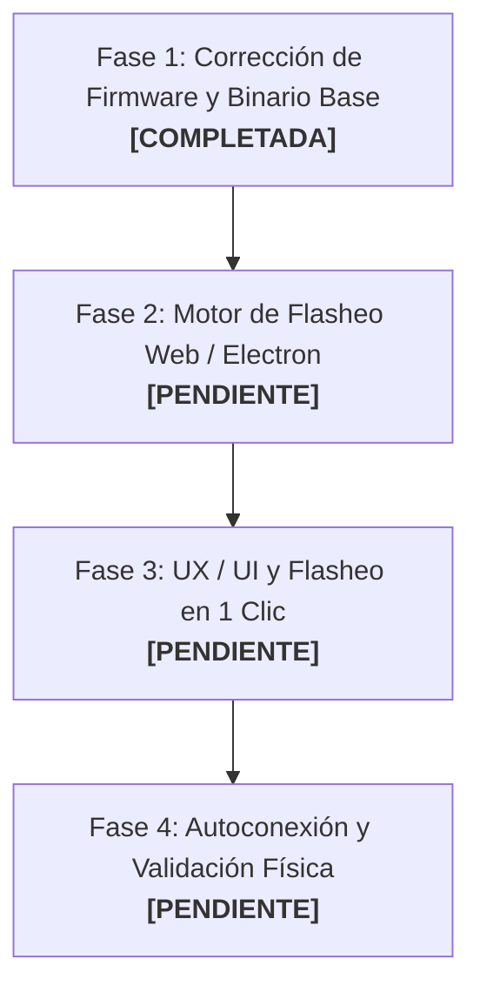

# Plan de Implementación: Flasheo de Live Bridge en 1 Clic (JWPLC HMI Designer)

> **Documento de Continuidad para el Proyecto JWPLC HMI Designer**  
> **Fecha:** Octubre 2026  
> **Rama:** `v2.1.0-alpha.15-HmiDesigner`  
> **Objetivo:** Permitir que el usuario conecte su JWPLC por USB y, si el microcontrolador no tiene instalado el firmware de streaming, la aplicación pueda flashearlo e inicializar el Preview en Vivo automáticamente en un solo clic, sin necesidad de abrir Arduino IDE.

---

## 1. Contexto y Diagnóstico Técnico

### 1.1. ¿Qué es el Live Preview?
Es la herramienta del HMI Designer (`poc/designer-live.js`) que transmite el framebuffer del canvas (320×170 px en RGB565) a la pantalla TFT física ST7789 del JWPLC a **921,600 baudios** con compresión RLE y detección de cuadros sucios (*dirty rects*).

### 1.2. El problema encontrado y resuelto en Fase 1
Al intentar compilar el sketch puente original [`JWPLC_HMI_Live_Bridge.ino`](gates/A11_LivePreview_WebSerial/JWPLC_HMI_Live_Bridge/JWPLC_HMI_Live_Bridge.ino) en Arduino IDE con el paquete de placa `2.1.0-alpha.12` / `alpha.15`, se producía el error:
```text
error: 'class JWPLC_TFTClass' has no member named 'drawRGBBitmap'
  223 | JWPLC_Display.tft().drawRGBBitmap(...)
```

**Causa:**
En Alpha 11, `JWPLC_Display` usaba `Adafruit_GFX`, la cual poseía el método `drawRGBBitmap`. Al evolucionar a la plataforma 2.1.0, se implementó la librería propietaria de alto rendimiento `JWPLC_TFTClass` (con mutex de hardware SPI en 80 MHz), la cual no incluye `drawRGBBitmap`.

**Solución aplicada:**
Se adaptó la función `drawBlock()` en `JWPLC_HMI_Live_Bridge.ino` para usar el contexto de dibujo por lotes nativo de la clase:
- `tft.beginBatch(50)` (toma el mutex de hardware `jwplcSPI_acquire` y abre la transacción SPI a 80 MHz).
- Mapeo de secuencias de píxeles horizontales contiguos con `tft.drawFastHLine()` y píxeles individuales con `tft.drawPixel()`.
- `tft.endBatch()` (cierra la transacción y libera el bus SPI para Ethernet/SD/FRAM).

---

## 2. Estado de las 4 Fases



---

### Fase 1: Corrección de Firmware y Compilación Base
* **Estado:** ✅ **COMPLETADA**
* **Resultados:**
  - `JWPLC_HMI_Live_Bridge.ino` compila con **0 errores y 0 advertencias** usando el core `jwplc:esp32:jwplcbasic`.
  - Uso de memoria: Sketch 427,241 bytes (10% flash), Variables 49,860 bytes (15% RAM).
  - Archivos generados en `tools/jwplc-hmi-designer/gates/A11_LivePreview_WebSerial/JWPLC_HMI_Live_Bridge/build/`:
    - `JWPLC_HMI_Live_Bridge.ino.bin` (binario de aplicación)
    - `JWPLC_HMI_Live_Bridge.ino.bootloader.bin`
    - `JWPLC_HMI_Live_Bridge.ino.partitions.bin`
    - `JWPLC_HMI_Live_Bridge.ino.merged.bin` (imagen completa flasheable)

---

### Fase 2: Paquetización del Binario y Motor de Flasheo
* **Estado:** ⏳ **PENDIENTE (Iniciar aquí en el siguiente chat)**
* **Objetivos:**
  1. **Elegir la estrategia de flasheo:**
     - **Opción Universal (Recomendada): `esptool-js`**
       - Librería oficial de Espressif en JavaScript que corre directamente en el navegador / Electron sobre **WebSerial**.
       - **Ventaja:** No requiere instalar Python ni ejecutar binarios externos. Funciona de forma idéntica en Google Chrome, Microsoft Edge y Electron.
     - **Opción Nativa Electron:**
       - Invocar en segundo plano `esptool.exe` (incluido en las herramientas de Arduino o empaquetado en release).
  2. **Ubicación de los artefactos:**
     - Copiar los archivos binarios compilados a una carpeta accesible por la app (ej. `tools/jwplc-hmi-designer/poc/firmware/` o empaquetada como asset en Electron).
     - La imagen merged (`.merged.bin`) o la terna de archivos (`bootloader @ 0x1000`, `partitions @ 0x8000`, `app @ 0x10000`).

---

### Fase 3: Integración en la Interfaz de Usuario (UX / UI)
* **Estado:** ⏳ **PENDIENTE**
* **Objetivos:**
  1. **Flujo de Detección en `designer-live.js`:**
     - Al hacer clic en **"Conectar JWPLC"**, la app abre el puerto serie seleccionado y envía el handshake `JWH?`.
     - Si pasan 2.5 segundos sin recibir `JWHMI_LIVE_READY 1`, la app despliega un modal interactivo:
       > **"Dispositivo detectado pero sin firmware Live Preview"**  
       > *El PLC conectado no tiene cargado el firmware de prueba. ¿Deseas instalarlo en 1 clic?*  
       > `[ Instalar Firmware Live ]` `[ Cancelar ]`
  2. **Modal con Barra de Progreso:**
     - Al pulsar "Instalar Firmware Live":
       - Reset a modo bootloader del ESP32 (DTR/RTS).
       - Barra de progreso interactiva (0% a 100%) mostrando la velocidad (921,600 baudios, ~3-4 segundos de duración).
       - Mensaje de confirmación: *"Firmware instalado con éxito. Reiniciando..."*.

---

### Fase 4: Autoconexión, Telemetría y Validación en Hardware
* **Estado:** ⏳ **PENDIENTE**
* **Objetivos:**
  1. **Handshake automático post-reinicio:**
     - El puerto COM se reabre a 921,600 baudios y captura la respuesta `JWHMI_LIVE_READY 1`.
     - El botón de la interfaz cambia inmediatamente a estado activo verde: `LIVE conectado`.
  2. **Pruebas de latencia y rendimiento:**
     - Verificar que los rectángulos sucios (*dirty rects*) alcancen entre **30 y 60 FPS** al editar campos dinámicos.
     - Validar que los cambios de página completos (FULL frame) se transmitan en menos de 100 ms gracias a la compresión RLE.
     - Monitorear la pestaña de *Diagnóstico* para confirmar 0 errores acumulados en el buffer SPI.

---

## 3. Instrucciones para el Siguiente Chat

Para retomar este trabajo en una nueva sesión, proporciona esta instrucción al asistente:

> *"Lee el archivo `tools/jwplc-hmi-designer/PLAN_LIVE_BRIDGE_FLASHER.md`. La Fase 1 ya fue completada exitosamente. Vamos a comenzar con la **Fase 2** para paquetizar el binario precompilado de `Live_Bridge` e integrar el motor de flasheo (usando `esptool-js` sobre WebSerial)."*
