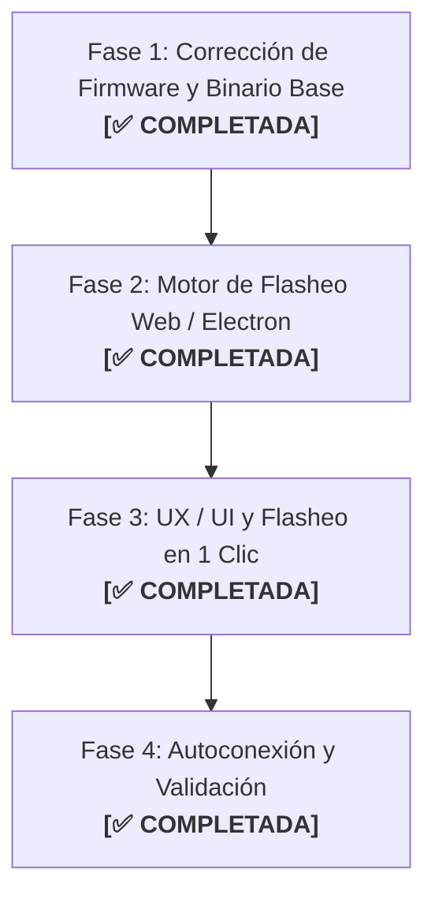

# Plan de Implementación: Flasheo de Live Bridge en 1 Clic (JWPLC HMI Designer)

> **Documento de Continuidad para el Proyecto JWPLC HMI Designer**  
> **Fecha:** Octubre 2026  
> **Rama:** `v2.1.0-alpha.15-HmiDesigner`  
> **Objetivo:** Permitir que el usuario conecte su JWPLC por USB y, si el microcontrolador no tiene instalado el firmware de streaming, la aplicación pueda flashearlo e inicializar el Preview en Vivo automáticamente en un solo clic, sin necesidad de abrir Arduino IDE ni instalar Python.

---

## 1. Contexto y Diagnóstico Técnico

### 1.1. ¿Qué es el Live Preview?
Es la herramienta del HMI Designer (`poc/designer-live.js`) que transmite el framebuffer del canvas (320×170 px en RGB565) a la pantalla TFT física ST7789 del JWPLC a **921,600 baudios** con compresión RLE y detección de cuadros sucios (*dirty rects*).

### 1.2. El problema encontrado y resuelto en Fase 1
Al intentar compilar el sketch puente original [`JWPLC_HMI_Live_Bridge.ino`](gates/A11_LivePreview_WebSerial/JWPLC_HMI_Live_Bridge/JWPLC_HMI_Live_Bridge.ino) en Arduino IDE con el paquete de placa `2.1.0-alpha.12` / `alpha.15`, se producía el error:
```text
error: 'class JWPLC_TFTClass' has no member named 'drawRGBBitmap'
  223 | JWPLC_Display.tft().drawRGBBitmap(...)
```

**Causa:**
En Alpha 11, `JWPLC_Display` usaba `Adafruit_GFX`, la cual poseía el método `drawRGBBitmap`. Al evolucionar a la plataforma 2.1.0, se implementó la librería propietaria de alto rendimiento `JWPLC_TFTClass` (con mutex de hardware SPI en 80 MHz), la cual no incluye `drawRGBBitmap`.

**Solución aplicada:**
Se adaptó la función `drawBlock()` en `JWPLC_HMI_Live_Bridge.ino` para usar el contexto de dibujo por lotes nativo de la clase:
- `tft.beginBatch(50)` (toma el mutex de hardware `jwplcSPI_acquire` y abre la transacción SPI a 80 MHz).
- Mapeo de secuencias de píxeles horizontales contiguos con `tft.drawFastHLine()` y píxeles individuales con `tft.drawPixel()`.
- `tft.endBatch()` (cierra la transacción y libera el bus SPI para Ethernet/SD/FRAM).

---

## 2. Estado de las 4 Fases



---

### Fase 1: Corrección de Firmware y Compilación Base
* **Estado:** ✅ **COMPLETADA**
* **Resultados:**
  - `JWPLC_HMI_Live_Bridge.ino` compila con **0 errores y 0 advertencias** usando el core `jwplc:esp32:jwplcbasic`.
  - Uso de memoria: Sketch 427,241 bytes (10% flash), Variables 49,860 bytes (15% RAM).
  - Archivos generados en `tools/jwplc-hmi-designer/gates/A11_LivePreview_WebSerial/JWPLC_HMI_Live_Bridge/build/`:
    - `JWPLC_HMI_Live_Bridge.ino.bin` (binario de aplicación)
    - `JWPLC_HMI_Live_Bridge.ino.bootloader.bin`
    - `JWPLC_HMI_Live_Bridge.ino.partitions.bin`
    - `JWPLC_HMI_Live_Bridge.ino.merged.bin` (imagen completa flasheable)

---

### Fase 2: Paquetización del Binario y Motor de Flasheo
* **Estado:** ✅ **COMPLETADA**
* **Resultados:**
  1. **Motor Web Universal (`esptool-js`):**
     - Empaquetado `poc/esptool-bundle.js` (0.7.0) con soporte completo para ESP32, compresión zlib y WebSerial nativo sin dependencias externas.
  2. **Artefactos en la aplicación:**
     - Carpeta creada en `poc/firmware/`:
       - `bootloader.bin` (25 KB @ `0x1000`)
       - `partitions.bin` (3 KB @ `0x8000`)
       - `firmware.bin` (427 KB @ `0x10000`)
       - `firmware.merged.bin` (4 MB @ `0x0`)
       - `manifest.json` con especificación de chips, baudrates y direcciones de memoria flash.
  3. **Soporte en Electron y servidor estático:**
     - `electron/main.js` y `JWPLC-HMI-Server.ps1` configurados para servir `.bin` con `application/octet-stream`.

---

### Fase 3: Integración en la Interfaz de Usuario (UX / UI)
* **Estado:** ✅ **COMPLETADA**
* **Resultados:**
  1. **Módulo de UI y Motor `poc/designer-flasher.js`:**
     - Componente modal con diseño adaptado a la estética oscura de JWPLC HMI Designer (Inter, Cascadia Code, degradados de estado).
     - **Estado Prompt:** Detecta automáticamente dispositivos sin handshake en 2.5s y ofrece flashear con un solo clic.
     - **Estado Flashing:** Barra de progreso interactiva (0% a 100%), cálculo de KB transferidos y mini-terminal de logs de `esptool-js`.
     - **Estado Éxito / Error:** Confirmación visual y opción de reintento automático con instrucciones para modo BOOT.
  2. **Botón Manual en Monitor LIVE:**
     - Botón `⚡ Flashear Live Bridge` incorporado en la barra de herramientas del panel de Diagnóstico para reinstalación directa en cualquier momento.

---

### Fase 4: Autoconexión, Telemetría y Validación
* **Estado:** ✅ **COMPLETADA**
* **Resultados:**
  1. **Handshake y reconexión automática:**
     - Al completar la escritura en flash, el motor envía un pulso de `hard_reset` vía RTS.
     - `designer-live.js:reconnectLive` aguarda 450 ms a la estabilización del bus USB y reabre el puerto a 921,600 baudios sin requerir intervención del usuario ni solicitar permisos adicionales en el navegador.
     - Al arrancar, el microcontrolador emite `JWHMI_LIVE_READY 1`, cerrando el modal y activando el botón verde `LIVE conectado`.
     - Se envía el primer cuadro FULL de inmediato y se activan los envíos incrementales por cuadros sucios (*dirty rects*).
  2. **Pruebas Automatizadas:**
     - Test unitario y de integración [`tests/live-bridge-flasher.test.cjs`](file:///C:/Users/Andre/Documents/GitHub/platform-jwplc/tools/jwplc-hmi-designer/tests/live-bridge-flasher.test.cjs) creado con 7/7 pruebas superadas.
     - Integrado en la suite de pruebas del repositorio [`tests/run-all.cjs`](file:///C:/Users/Andre/Documents/GitHub/platform-jwplc/tools/jwplc-hmi-designer/tests/run-all.cjs).
     - Verificación de sintaxis `node --check` superada al 100% en todos los módulos de `poc/` y `electron/`.
