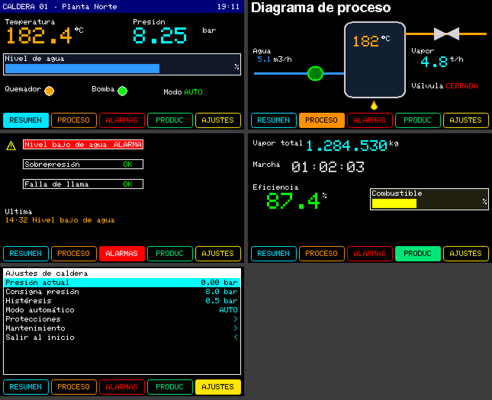

# Prueba 01: Caldera 01

**Pedido (Jeykco, 2026-10-23):** «hacer una interfaz para ver hasta dónde puede llegar una IA generando algo en HMI Designer».
El agente eligió el tema (caldera industrial) y escribió [`caldera_01.json`](caldera_01.json) sin abrir la UI.



## Contenido

| Página | Objetos |
|---|---|
| Resumen | Barra de título con reloj del RTC, temperatura y presión grandes, nivel de agua (BAR), pilotos de quemador y bomba, modo |
| Proceso | Diagrama con figuras: tubería (LINE), bomba (ELLIPSE), caldera (RECT redondeado), válvula (dos TRIANGLE rotados), llama en capas PIXEL, caudales y estado de válvula |
| Alarmas | Tres BOOL con fondo rojo en alarma, ícono de aviso en PIXEL, última alarma (TEXT) |
| Producción | Vapor total con separador de miles, horómetro (DURATION), eficiencia, combustible (BAR) |
| Ajustes | MENU con consignas, modo, submenús Protecciones y Mantenimiento, Salir al inicio |

NAV_BAR `industrial-color` con nombre corto y color por página. Arranque en IDLE, vuelta por inactividad (300 s).
31 de los 32 objetos permitidos y 3 capas PIXEL.

## Verificación

- `jwhmi validate`: 0 errores, 0 avisos. `[ejecutado]`
- `jwhmi check`: el sketch base compila en host (g++) contra los headers del package y las llamadas existen. `[ejecutado]`
- Compilación ESP32 real (`tools/alpha15/regenerate_libJWPLC_TFT.sh compile`): 461 837 bytes de programa (11 %),
  39 412 bytes de RAM (12 %). `[ejecutado]`
- Prueba en la placa: `[no verificado]`.

## Lo que encontró el agente

- La CLI aceptaba dos campos con la misma variable (la temperatura en Resumen y en Proceso) y el Designer la rechaza.
  Corregido en el PR #144: cada campo usa su variable (`temperatura`, `tempHogar`).
- Las capas PIXEL quedan detrás de las figuras: la llama se movió debajo de la caldera.
- La vista previa usa como muestra el máximo de dígitos reservados; se pusieron `preview` realistas.

## Regenerar

```bash
J="node tools/jwplc-hmi-designer/cli/jwhmi.cjs"
P=tools/jwplc-hmi-designer/pruebas-ia/01_caldera
$J check $P/caldera_01.json
$J build $P/caldera_01.json --sketch $P/Caldera_01 --preview
```
