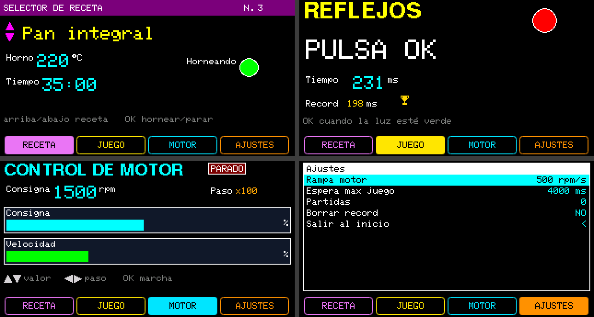

# Prueba 02: Botonera interactiva

**Pedido (Jeykco, 2026-10-23):** «otra prueba más creativa, algo más interactivo con la botonera».
El agente escribió el diseño en [`botonera.json`](botonera.json) con la CLI y la lógica en
[`Botonera_Interactiva.ino`](Botonera_Interactiva/Botonera_Interactiva.ino): las teclas hacen algo más
que cambiar de página.



## Cómo se usa

En el selector de páginas ◀ ▶ cambian de página y **OK entra**. Dentro de una página las teclas son
del sketch y **ESC vuelve** al selector (reglas de `JWPLC_UI_Pages`: el sketch sólo lee teclas en modo
contenido, nunca en el selector ni en la página del MENU).

| Página | Teclas | Qué pasa |
|---|---|---|
| Receta | ▲▼ elige entre 5 recetas · OK hornea / para | Nombre, temperatura y tiempo cambian con la receta. OK arranca la cuenta atrás (MM:SS) y enciende el piloto «Horneando»; sigue aunque salgas de la página. |
| Reflejos | OK empieza · OK cuando la luz se pone verde | Juego de tiempo de reacción: espera aleatoria (1,5 s a «Espera max juego»), «TEMPRANO!» si te adelantas, «LENTO...» pasados 2 s. Mide en ms, guarda el récord y muestra el trofeo (PixelMap). |
| Motor | ▲▼ consigna · ◀ ▶ paso x1/x10/x100 · OK marcha/paro | La velocidad sigue a la consigna con la rampa del MENU (rpm/s); en paro baja a 0. Dos barras: consigna y velocidad real. |
| Ajustes | MENU (firmware) | Rampa del motor, espera máxima del juego, partidas jugadas, «Borrar record» (vuelve solo a NO) y salir al inicio. |

## Verificación

- `jwhmi validate`: 0 errores, 0 avisos. 30 de 32 objetos, 1 PixelMap. `[ejecutado]`
- Compilación en host (g++ `-Wall -Wextra`) del `.ino` real contra los headers del package, con un
  `JWPLC_Buttons` falso. `[ejecutado]`
- Compilación ESP32 real (`tools/alpha15/regenerate_libJWPLC_TFT.sh compile`, `jwplc_local:esp32:jwplcbasic`):
  463 029 bytes de programa (11 %), 38 276 bytes de RAM (11 %). `[ejecutado]`
- Prueba en la placa (teclas, refresco, trofeo): `[no verificado]`.

## Lo que encontró el agente

- **El IDE de Arduino coloca los prototipos antes que los `enum`.** `terminar(EstadoJuego, …)` compilaba en
  host pero no en ESP32 (`'EstadoJuego' was not declared`). Se pasa como `uint8_t`. Sólo la compilación
  ESP32 real lo detecta: en host el `.ino` se compila como C++ sin ese paso.
- `setPixelMapVisible()` redibuja la página entera: el sketch sólo lo llama cuando el trofeo cambia.
- `barValue` (muestra del lienzo) va en unidades de la variable (0..3000), no en %.
- `min`/`max` de Arduino no están en el stub de host: se usa una función `limitar()` propia.
- No hay flechas en la fuente GLCD: las de las pistas son `TRIANGLE` rotados.

## Regenerar

```bash
J="node tools/jwplc-hmi-designer/cli/jwhmi.cjs"
P=tools/jwplc-hmi-designer/pruebas-ia/02_botonera
$J validate $P/botonera.json
$J build $P/botonera.json --sketch $P/Botonera_Interactiva --preview   # no toca el .ino
tools/alpha15/regenerate_libJWPLC_TFT.sh compile $P/Botonera_Interactiva
```
