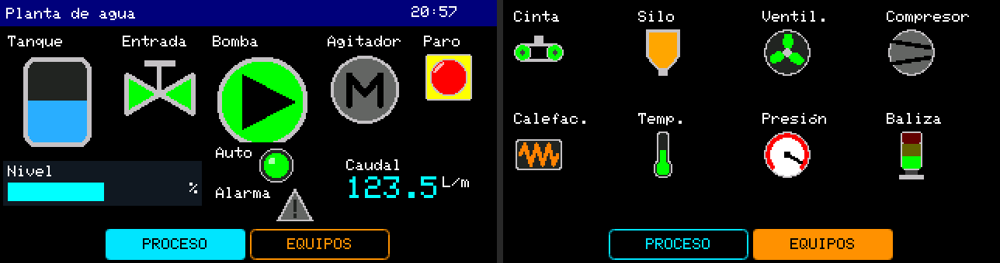

# Prueba 03: Iconos con estado

**Pedido (Jeykco, 2026-10-23):** sección de iconos con estado (motores, pilotos, válvulas…) ligados a
variables, sin animación. Esta prueba usa el tipo `ICON` desde la CLI, como lo haría un agente.
Diseño en [`planta_iconos.json`](planta_iconos.json); lógica en
[`Planta_Iconos.ino`](Planta_Iconos/Planta_Iconos.ino): una planta de agua simulada.



## Cómo se usa

| Página | Qué muestra | Teclas (modo contenido) |
|---|---|---|
| Proceso | Tanque (4 estados por nivel), válvula de entrada, bomba, agitador, paro, piloto de modo y alarma; barra de nivel y caudal. | OK paro de emergencia (enclavado) · ▲ automático/manual · ▼ simula falla de la bomba |
| Equipos | Cinta, silo, ventilador, compresor, calefacción, temperatura, presión y baliza, cada uno con el estado que le toca a la simulación. | (ninguna) |

El tanque se llena por la válvula (bajo 20 % hasta 90 %) y la bomba lo vacía (sobre 60 % hasta 25 %).
Con el paro todo se detiene y la baliza y el piloto pasan a rojo; con la falla, la bomba muestra su
estado 2 y la presión «Alta».

## Verificación

- `jwhmi validate`: 0 errores, 0 avisos. 21 de 32 objetos (15 ICON). `[ejecutado]`
- Header: 15 `JWPLC_UIIcon` (dos de 64 px, dos de 48, nueve de 32 y dos de 24). `[ejecutado]`
- Compilación ESP32 real (`tools/alpha15/regenerate_libJWPLC_TFT.sh compile`, `jwplc_local:esp32:jwplcbasic`):
  468 161 bytes de programa (11 %), 39 076 bytes de RAM (11 %), sin avisos. `[ejecutado]`
- El lienzo dibuja igual que el firmware píxel a píxel (`tests/icon-smoke.cjs`, `JWPLC_UI.cpp` real en host). `[ejecutado]`
- Prueba en la placa (colores, repintado al cambiar de estado): `[no verificado]`.

## Lo que encontró el agente

- Los nombres de los estados quedan en el comentario de cada variable del header
  (`uint8_t bomba = 0; // ICON: 0=Parado 1=En marcha 2=Falla`) y la guía del sketch los copia: no hace
  falta abrir el catálogo para escribir la lógica. Se agregó durante esta prueba.
- `iconSize` que no existe (p. ej. 40) se lleva al tamaño más cercano al normalizar; `validate` sólo
  falla si el `.jwhmi` ya normalizado trae un tamaño que el icono no tiene.
- Con varios estados la variable es `uint8_t` y el sketch usa constantes propias (`enum : uint8_t`) para
  no escribir números sueltos.

## Regenerar

```bash
J="node tools/jwplc-hmi-designer/cli/jwhmi.cjs"
P=tools/jwplc-hmi-designer/pruebas-ia/03_iconos
$J icons
$J validate $P/planta_iconos.json
$J build $P/planta_iconos.json --sketch $P/Planta_Iconos --preview   # no toca el .ino
tools/alpha15/regenerate_libJWPLC_TFT.sh compile $P/Planta_Iconos
```
