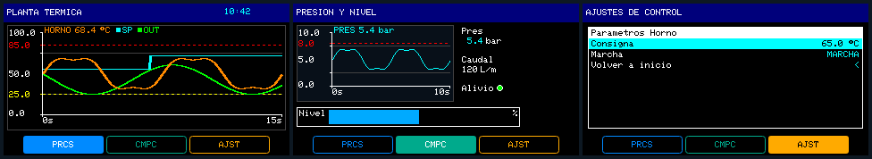

# Prueba 04: Gráficas de tendencia (`TREND`)

Prueba generada por IA desde la especificación JSON para mostrar todas las capacidades actuales de `JWPLC_UITrendField` y `JWPLC_UITrendConfig`, tanto en el lienzo del HMI Designer como en el firmware (`JWPLC_Display`).

Diseño en [`tendencias.json`](tendencias.json); lógica en [`Tendencias_04.ino`](Tendencias_04/Tendencias_04.ino): simulación térmica no bloqueante con control de consigna y registro en MicroSD.



## Contenido

| Página | Objetos |
|---|---|
| `Proceso` (`PRCS`) | Barra de título con reloj RTC (`DATETIME`) + gráfica `TREND` de pantalla principal (`312×118`, muestreo `250 ms`, 3 canales: `HORNO`, `SP` y `OUT`, 2 umbrales punteados en `85.0 °C` rojo y `25.0 °C` amarillo, guías `25%`/`50%`/`75%`, grosor `2 px`, registro continuo en MicroSD `/TREND_2.CSV` cada `500 ms`). |
| `Compacta` (`CMPC`) | Gráfica `TREND` compacta (`176×86`) en escala `MANUAL` (`0..10 bar`, grosor `1 px`, umbral en `8.0 bar`) conviviendo con `VALUE` (`Pres`, `Caudal`), piloto `BOOL` (`Alivio`) y `BAR` (`Nivel`). |
| `Ajustes` (`AJST`) | `MENU` conectado al lazo térmico para editar en vivo la consigna (`EDIT_NUM`, `20..95 °C`), marcha/paro (`EDIT_BOOL`) y volver al inicio (`GO_IDLE`). |

`NAV_BAR` con preset `industrial-color` y nombres cortos por página.

## Verificación

- `jwhmi validate tendencias.json --fast`: `0` errores, `0` avisos. `[ejecutado]`
- Generación real desde el Designer (Chrome headless vía CDP sobre `poc/desktop.html`): `0` identificadores duplicados, `0` avisos de geometría (`15` cajas revisadas) y vistas previas PNG generadas en [`Tendencias_04/hmi_preview/`](Tendencias_04/hmi_preview). `[ejecutado]`
- Simulación en `jwsim-cli` (`Tendencias_04.exe`, `--until 6000`): ejecución limpia sin bloqueos y paridad visual confirmada en la ST7789 simulada (`HORNO` con 3 curvas continuas, escalas `0.0/50.0/100.0`, umbrales `25.0`/`85.0` y barra `PRCS / CMPC / AJST`). `[ejecutado]`
- Compilación ESP32 real (`arduino-cli.exe --fqbn jwplc_local:esp32:jwplcbasic`): `504 725` bytes de programa (`12 %`), `51 588` bytes de variables globales (`15 %`), sin errores. `[ejecutado]`
- Prueba física en placa JWPLC Basic (contraste TFT y MicroSD física): `[no verificado]`.

## Lo que encontró el agente

- Si un `TREND` declara un segundo o tercer canal (`ch2Variable` / `ch3Variable`) con el **mismo nombre** que un nodo `EDIT_*` del `MENU`, `designer-codegen.js` y `designer-menu.js` emiten dos declaraciones `float <variable>` distintas en `JWPLC_HMI_Generated.h` (colisión de redeclaración C++). En `tendencias.json` se separó `consignaHorno` (canal 2 del `TREND`) de `consignaSetpoint` (nodo del `MENU`), copiando su valor en el `.ino`.
- Las gráficas `BAR` con etiqueta superior (`STACKED`) y `barHeight: 24` alcanzan `y >= 147` si arrancan en `y = 115`; cambiar `layout: "INLINE"` con `barHeight: 16` deja libre la `NAV_BAR` inferior sin solapes.

## Regenerar

```bash
J="node tools/jwplc-hmi-designer/cli/jwhmi.cjs"
P=tools/jwplc-hmi-designer/pruebas-ia/04_tendencias
$J validate $P/tendencias.json
$J check $P/tendencias.json
$J build $P/tendencias.json --sketch $P/Tendencias_04 --preview
```
